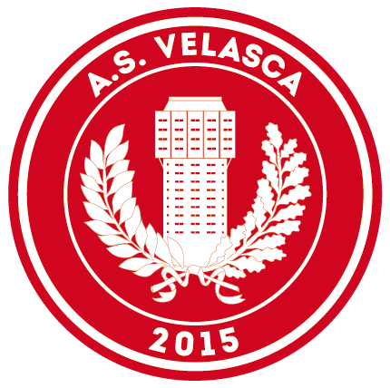

<p align="center">
  
</p>

# Official A.S. Velasca website

**"We are all but a football team"**
**“It is not a football club, it’s not a work of art, it’s all that at once”**

## The project

Friends that are dreamers, artists and football enthusiasts and who aim to offer the Lombard regional capital a real new alternative to supporters. Visionaries? Passionate? Deluded? Most probably, but in the ever changing and so acclaimed Milan all this sounds mighty good. Planet football does not give away anything and we, who want to take everything without rushing anything, will start from below, the bottom even, from the lowest tier of the Italian Football Federation.

The province and the mud, the goals and the provocations, the beauty and the roughness of football, much like our inspiration, Milan’s Torre Velasca, too ‘bizarre’ to be in the city’s historical centre, but fascinating and hard to imitate, sticking out like a supporter’s sore thumb, disgustingly beautiful.

Velasca is a long-term project, where the game’s rectangle will be wrapped up, even if only metaphorically, in a media component decidedly too big compared to the importance of the championship. This imbalance will bring the supporters closer to a more genuine football and will ensure that we grow together, because despite our size we dream big, and because to arrive at the twenty-sixth floor we inevitably have to start from the first.

a project by **Marco De Girolamo**, **Karim Khideur**, **Loris Mandelli**, **Wolfgang Natlacen** and **Clément Tournus**.

a site by **Kevin Martin** · [kma.studio](https://kma.studio)

# Technologies

**MR are welcome and fully appreciated**

## Stack

- ⚛️ `react` 19 + `react-router` (data router, lazy routes, view transitions)
- ⚡️ `vite`
- 🖍 `sass` (BEM, one stylesheet per component) and Archivo variable font (self-hosted)
- 🧼 `dompurify` for the HTML coming from the CMS
- 🧪 `vitest` + Testing Library
- 🗄 Content: Cockpit CMS (`cms.asvelasca.it`), see [docs/cockpit-upgrade.md](docs/cockpit-upgrade.md)

## Installation

Node 22.12+ (24 recommended), then:

```sh
cp .env.example .env   # fill API_TOKEN with a read-only Cockpit key
yarn install
```

## Tasks

- `yarn dev`: start the dev server
- `yarn build`: production build in `dist/` (the folder is emptied first)
- `yarn preview`: serve the production build locally
- `yarn test`: run the tests
- `yarn lint`: lint the code
- `yarn format`: format JS and SCSS

## Deploy

By hand, from a machine with an up-to-date `.env`:

1. `yarn build`
2. Upload the content of `dist/` to the site folder over FTP, **including the hidden `.htaccess`**
   (SPA fallback, security headers, caching): without it, reloading a page such as `/it/home` gives a 404.

GitHub Actions (`.github/workflows/ci.yml`) only runs lint, tests and a build check on `develop` and on
pull requests. It deploys nothing and needs no secret.

## License

[MIT](https://choosealicense.com/licenses/mit/)
